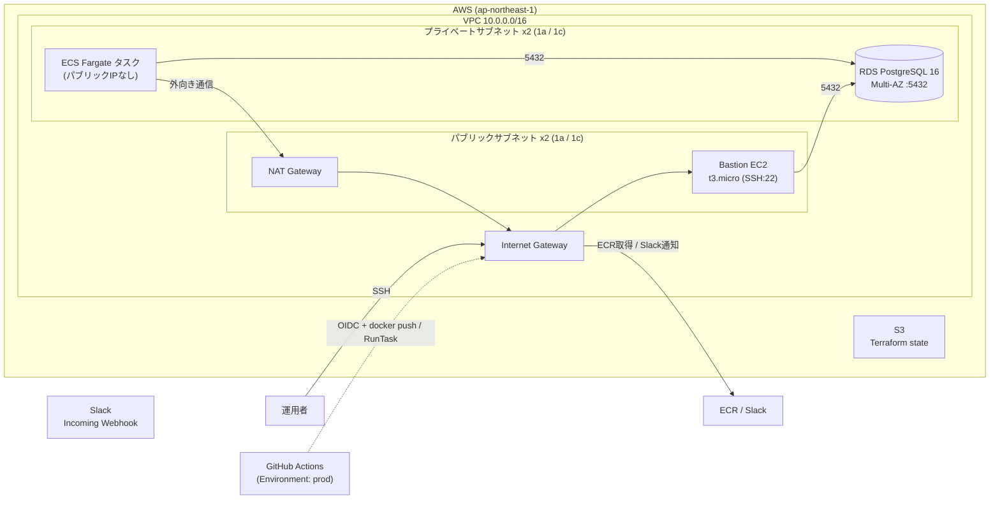
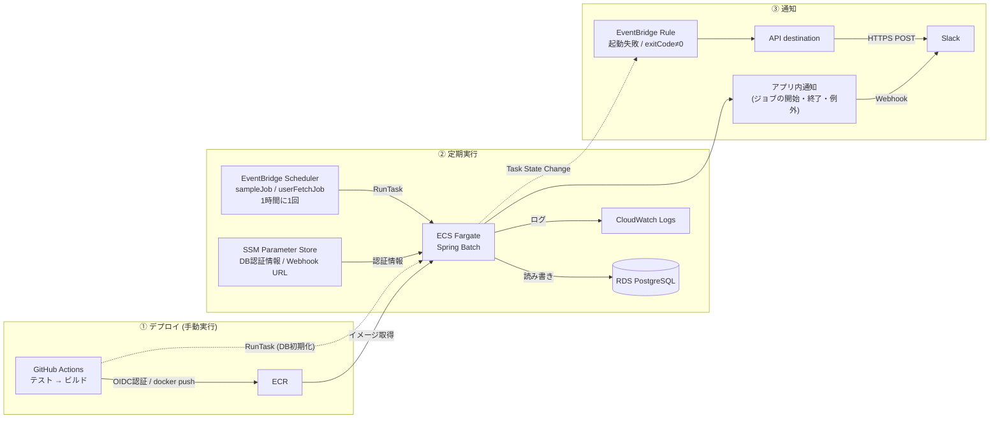

# spring-batch-v1-monorepo

Spring Batch アプリケーションと、それを AWS（ECS Fargate + EventBridge Scheduler + RDS）で動かすための Terraform インフラを一つにまとめたモノレポです。

## ディレクトリ構成

```
.
├── apps/
│   └── spring-batch-app-v1/   # Spring Boot / Spring Batch アプリ（Java 21, Gradle）
├── infra/
│   ├── common/                # 共有インフラ（VPC・RDS・S3・OIDC Provider）
│   └── individual/            # アプリ個別インフラ（ECR・ECS・EventBridge・GitHub Actions用IAM）
└── .github/workflows/         # CI/CD（テスト → イメージビルド → ECRプッシュ）
```

| 対象 | 詳細ドキュメント |
|---|---|
| アプリ | [apps/spring-batch-app-v1/README.md](apps/spring-batch-app-v1/README.md) |
| インフラ | [infra/README.md](infra/README.md) |

## アーキテクチャ

Terraform の定義に基づく構成を、「ネットワーク構成」と「処理の流れ」の2つに分けて示します。

### ネットワーク構成



- ECS タスクと RDS はプライベートサブネットに置き、外部への通信（ECR 取得・Slack 通知）は NAT Gateway を経由します。
- RDS のセキュリティグループは、プライベートサブネットと Bastion からの 5432 を許可します。
- Terraform の state は S3 に保存します（`bootstrap` で作成）。

### 処理の流れ



- アプリ起動後の結果は、アプリ内の通知（`SlackJobExecutionListener`）が Slack に送ります。
- イメージ取得失敗や起動直後のクラッシュなど、アプリが通知できない異常は、EventBridge ルールが検知して Slack に送ります（`JOB_NAME` を指定して起動したタスクのみ）。

## CI/CD

GitHub Actions のワークフローは、リポジトリルートの `.github/workflows/` に2ファイルだけ置いています。

| ワークフロー | 起動 | 内容 |
|---|---|---|
| `ci.yml` | PR の作成時、およびその PR ブランチへのコミット時 | JUnit のテスト。`deploy.yml` からも再利用される |
| `deploy.yml` | 手動（ブランチを選んで実行） | イメージのビルド → ECR プッシュ、DB 初期化（実行内容はチェックボックスで選択） |

### `deploy.yml` の実行のしかた
GitHub の **Actions** タブで **Deploy** を選び、**Run workflow** で**実行するブランチ**と**実行内容**を選んで実行します。

| 入力 | 既定値 | 内容 |
|---|---|---|
| `push_image` | ON | テスト（`ci.yml`）→ Docker イメージのビルド → ECR へプッシュ（コミットSHAと `latest` のタグ） |
| `init_db` | OFF | VPC 内で ECS の単発タスクを起動し、`sql/schema.sql` で RDS にテーブルを作成する（データは投入しない。繰り返し実行しても安全） |

両方を選んだ場合は、イメージのプッシュ後に DB 初期化を実行します。RDS はプライベートサブネットにあり GitHub のランナーから届かないため、DB 初期化は ECS の単発タスクとして実行しています。

### AWS への認証（GitHub Environments + OIDC）
AWS に触れるジョブ（`deploy.yml` の `push-image`、`init-db`）は、GitHub の Environment `prod` を使って実行します。
IAM ロールの信頼ポリシーは、次の条件に一致するジョブだけを許可しています。

```
repo:sukunahikona@<オーナーID>/spring-batch-v1-monorepo@<リポジトリID>:environment:prod
```

- Environment を使わないジョブ（PR のジョブなど）は、AWS のロールを引き受けられません。
- ブランチに関係なく Environment `prod` を使えるため、**どのブランチから実行できるかは GitHub の Environment 設定で制御します**（Settings → Environments → prod → Deployment branches and tags、必要なら Required reviewers）。
- Environment `prod` は、ワークフローの初回実行時に自動作成されます（保護ルールは未設定の状態）。
- オーナーIDとリポジトリIDは、OIDC トークンの `sub` に含まれる不変の数値です（`infra/individual/env/prod/terraform.tfvars`）。

ロールの権限は、ECR への push と、単発の ECS タスクの起動・確認に限定しています。

### 初期設定

1. `infra/common/env/prod/bootstrap` → `infra/common/env/prod` → `infra/individual/env/prod` の順に `terraform apply`
2. individual スタックの出力 `github_actions_role_arn` を、GitHub の Environment `prod` の Variables に `AWS_ROLE_ARN` として登録する（Settings → Environments → prod → Environment variables）。アカウント ID をリポジトリに書かないためで、秘密情報ではないため Secrets ではなく Variables で足りる

```bash
gh variable set AWS_ROLE_ARN --env prod --repo sukunahikona/spring-batch-v1-monorepo \
  --body "$(cd infra/individual/env/prod && terraform output -raw github_actions_role_arn)"
```
3. 手動で `Deploy` を実行する（`push_image` でイメージを ECR にプッシュし、`init_db` でテーブルを作成する）

## Slack 通知

バッチの起動前・終了後に、Slack の Incoming Webhook へ通知します（`SlackJobExecutionListener`。全ジョブに登録済み）。

| タイミング | 通知内容 |
|---|---|
| 起動前 | ジョブ名・executionId |
| 終了後 | 正常/異常、status、exit、所要時間（異常時はエラー内容の先頭300文字） |

Webhook URL は SSM Parameter Store の `/spring-batch-v1/prod/slack/webhook_url`（SecureString）から、ECS タスクの環境変数 `SLACK_WEBHOOK_URL` として渡されます。
未設定、または `https://hooks.slack.com/` 以外の値（初期値 `dummy` を含む）の場合は通知せず、ジョブにも影響しません。通知に失敗してもジョブは失敗させず、警告ログのみ出力します。

### 設定手順

1. Slack App を作成し、Incoming Webhooks を有効化して、通知先チャンネルの Webhook URL を発行する
2. 発行した URL を SSM に登録する（ECS タスクは起動のたびに読み込むため、再デプロイ不要）

```bash
aws ssm put-parameter --region ap-northeast-1 \
  --name /spring-batch-v1/prod/slack/webhook_url \
  --type SecureString --overwrite --value '<Webhook URL>'
```

ローカル実行で試す場合は、環境変数 `SLACK_WEBHOOK_URL` に Webhook URL を指定します。

## 命名規則

Terraform の `project`（`spring-batch-v1`）と `environment`（`prod`）から、AWS リソース名が `spring-batch-v1-prod-*` の形で決まります。
プロジェクト名を変える場合は、次の箇所を揃えて変更してください（S3 バケット名はグローバルで一意）。

- `infra/common/env/prod/terraform.tfvars` / `infra/individual/env/prod/terraform.tfvars` / `infra/common/env/prod/bootstrap/terraform.tfvars` の `project`
- `infra/common/env/prod/bootstrap/terraform.tfvars` の `state_bucket_name`
- 両スタックの `backend.tf` の `bucket`（Terraform の制約で変数化できない）
- `.github/workflows/deploy.yml` の `env`（`ECR_REPOSITORY`、`ECS_CLUSTER`、`TASK_DEFINITION`、`LOG_GROUP`、`PROJECT_ENV`）
